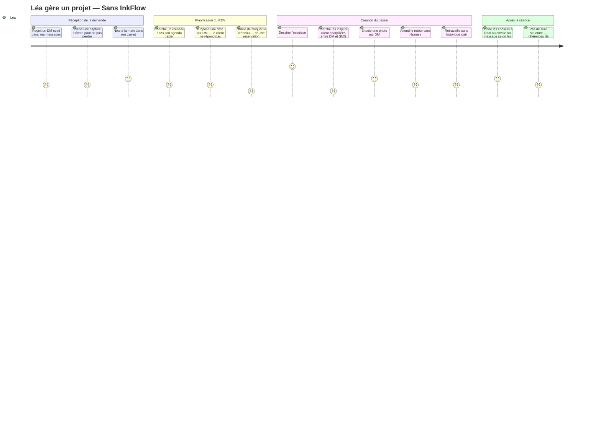
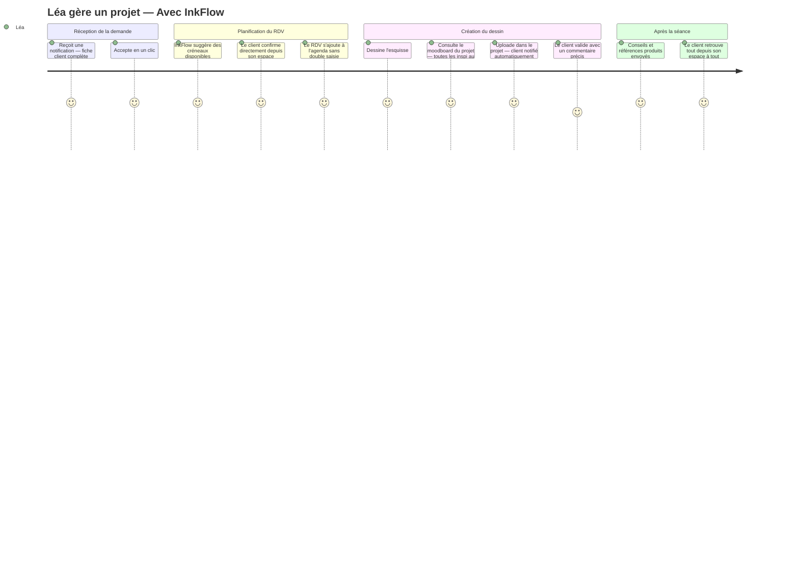

# 🗺 User Journey — InkFlow

> Parcours de **Léa**, tatoueure indépendante.
> Base : personas + connaissance métier · À affiner après retours terrain.

---

## De la demande à la séance

### Sans InkFlow

---

### Avec InkFlow

---

> Ces parcours sont hypothétiques et seront ajustés suite aux retours du sondage terrain.
